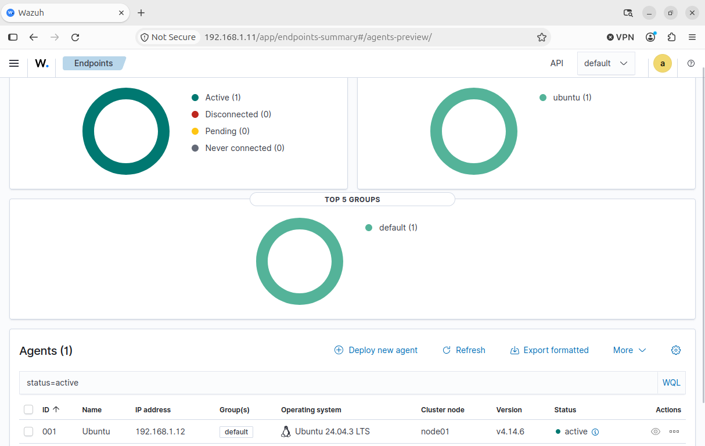
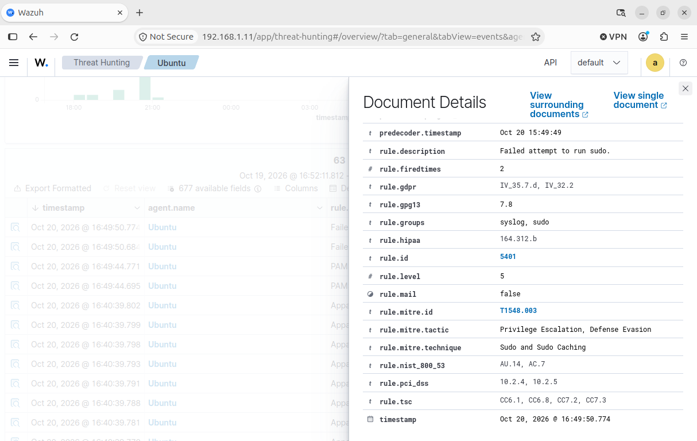
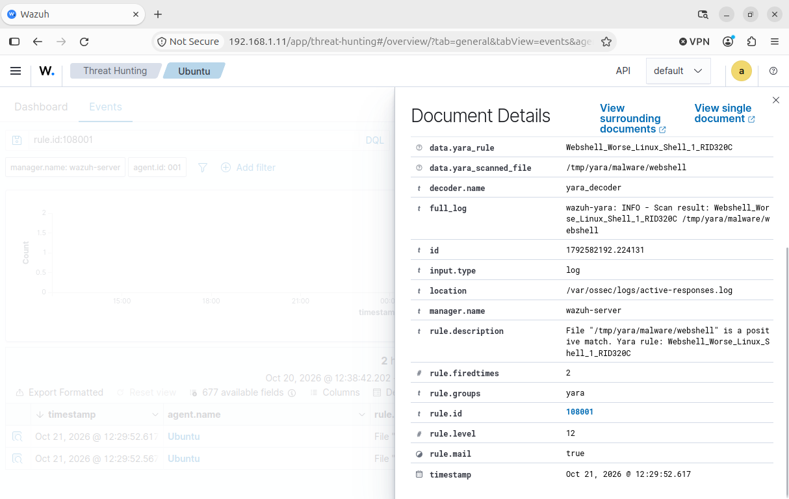
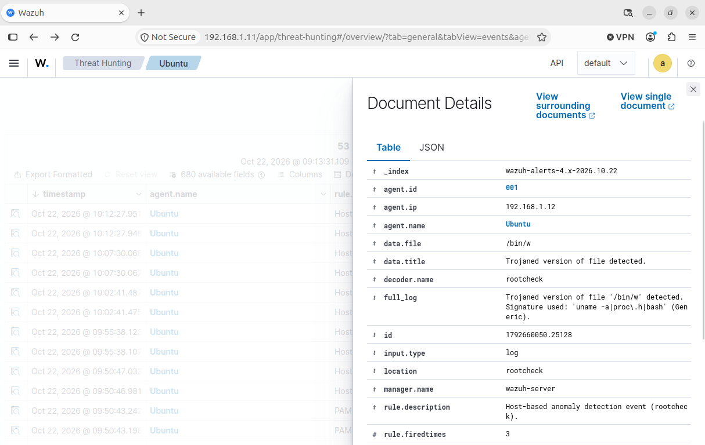
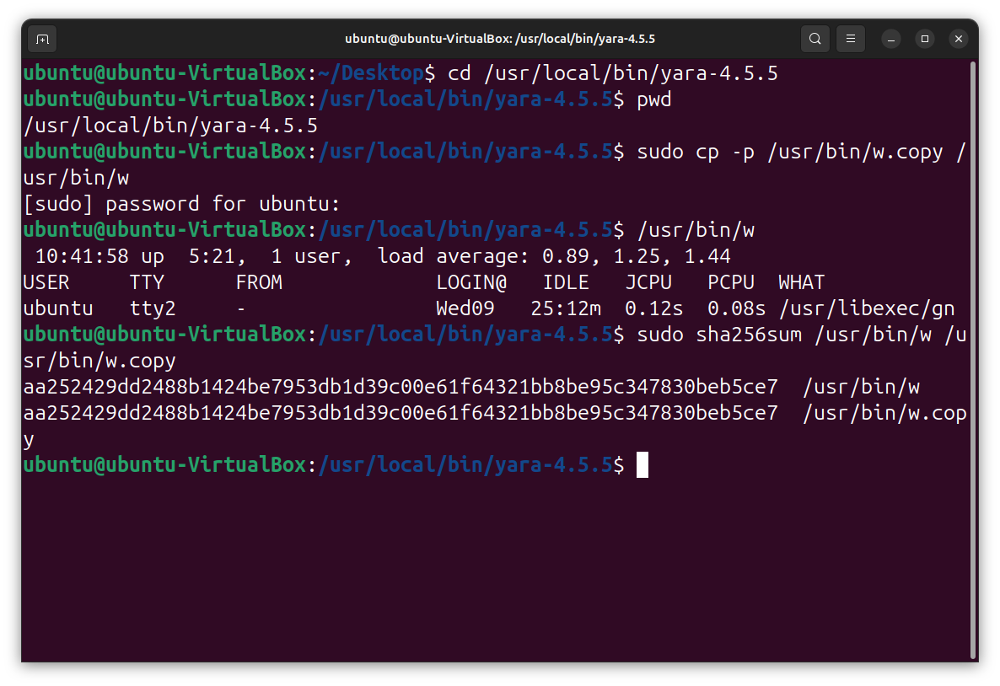
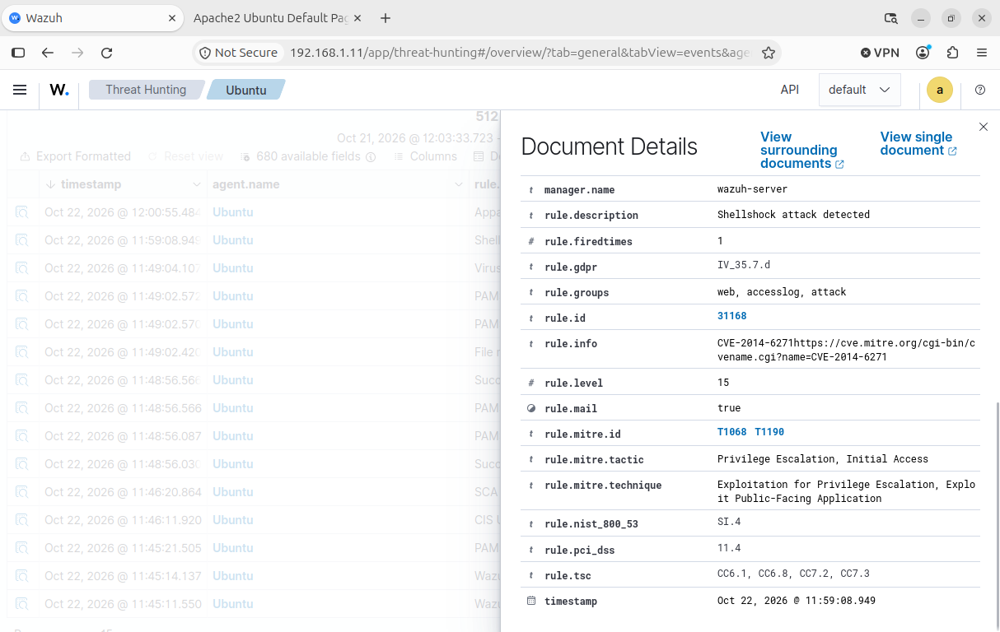

# Cybersecurity Capstone Portfolio: Phishing Investigation, Threat Detection and Incident Response Using Wazuh

This cybersecurity capstone portfolio documents practical Security Operations Centre (SOC) investigations involving phishing email analysis, endpoint monitoring, malware-pattern detection and incident response. The project combines the investigation of four simulated phishing emails with hands-on Wazuh security monitoring exercises in a controlled virtual laboratory. It demonstrates technical skills in threat detection, alert analysis, evidence collection, incident classification and security reporting.

**Project Period:** October 2026  
**Environment:** Controlled cybersecurity training laboratory

**Project Contributors:**
- **Part A — Phishing Investigation:** Alex Osale
- **Part B — Wazuh Threat Detection:** Alex Osale and Raheemah Lartey

## Table of Contents

- [Project Overview](#project-overview)
- [Network Topology](#network-topology)
- [Tools and Technologies](#tools-and-technologies)
- [Configuration Steps](#configuration-steps)
- [Results and Findings](#results-and-findings)
- [Author](#author)

## Project Overview

### Project Purpose

The purpose of this capstone project was to demonstrate practical cybersecurity investigation and threat-detection capabilities through two complementary workstreams.

**Part A — Phishing Investigation**

This workstream involved the static analysis of four instructor-provided synthetic phishing emails to identify suspicious sender information, deceptive links, social-engineering techniques and potential security risks.

The investigation focused on:

- Examining email headers and sender identities.
- Identifying discrepancies between `From`, `Return-Path` and `Reply-To` addresses.
- Reviewing reported **SPF**, **DKIM** and **DMARC** authentication results.
- Identifying suspicious URLs and attachment types.
- Recognising social-engineering techniques, including urgency, impersonation and financial pressure.
- Documenting indicators and recommending appropriate incident-response actions.

**Part B — Threat Detection and Incident Response Using Wazuh**

This workstream involved configuring and monitoring an Ubuntu endpoint using Wazuh, conducting authorised security simulations and analysing the resulting alerts.

The exercises covered:

- **Task 5:** Endpoint monitoring and failed sudo authentication detection.
- **Task 6:** Malware-pattern detection using YARA 4.5.5.
- **Task 7:** Suspicious Linux system binary detection using Wazuh Rootcheck.
- **Task 8:** Detection of a Shellshock-style HTTP attack attempt.

### SOC Investigation Workflow

The project demonstrated the following security operations workflow:

**Preparation → Evidence Collection → Detection → Triage → Analysis → Disposition → Response → Verification → Reporting**

The objective was to distinguish genuine observations from unverified claims and demonstrate defensible security investigation practices.

## Network Topology

### Virtual Laboratory Architecture

Part B was conducted in a controlled virtual environment using **Oracle VirtualBox**.

The laboratory consisted of a Wazuh manager, an Ubuntu endpoint, a Kali Linux attack-simulation machine and pfSense networking infrastructure.

| System | IP Address | Purpose |
|---|---|---|
| Wazuh Manager | `192.168.1.11` | Centralised security monitoring, alert processing and investigation |
| Ubuntu 24.04.3 LTS | `192.168.1.12` | Monitored endpoint running the Wazuh agent |
| Kali Linux | `192.168.1.14` | Authorised security testing and attack simulation |
| pfSense | Not specified in the report | Virtual network gateway and networking infrastructure |
| Windows Host | Not specified in the report | Host system running the virtual laboratory |

**Wazuh Manager Version:** 4.14.6  
**Wazuh Agent ID:** `001`

### Network Communication

- The **Ubuntu endpoint** generated system events and security telemetry.
- The **Wazuh agent** forwarded monitored events to the Wazuh manager.
- The **Wazuh manager** processed events and generated alerts using configured detection rules.
- **Kali Linux** was used to generate authorised attack traffic against the Ubuntu test environment.
- **pfSense** supported the existing virtual network configuration.
- The original laboratory network topology was preserved throughout the exercises.

### Monitored Directories and Logs

- `/tmp/yara/malware` — Directory monitored for suspicious file activity.
- `/var/log/apache2/access.log` — Apache web server access logs.
- `/usr/bin/w` — Linux system utility used in the Rootcheck simulation.
- `/root` — Security-sensitive directory used in the broader endpoint-monitoring exercises.

### Time Synchronisation

Network Time Protocol (**NTP**) was enabled and system clock synchronisation was checked to support accurate event correlation.

The project report records that the Ubuntu endpoint displayed **Africa/Lagos (UTC+1)** while the Wazuh manager displayed **UTC**. These differences were considered when interpreting timestamps.

## Tools and Technologies

### Security Monitoring and Detection

- **Wazuh 4.14.6** — Centralised security monitoring, log analysis and alert generation.
- **Wazuh Agent** — Collected endpoint security telemetry from Ubuntu.
- **File Integrity Monitoring (FIM)** — Detected changes to monitored files and directories.
- **YARA 4.5.5** — Identified files matching defined malware-related patterns and signatures.
- **Wazuh Rootcheck** — Identified suspicious host changes and potential system anomalies.
- **Wazuh Active Response** — Supported configured security-response workflows.
- **Apache HTTP Server** — Generated web access logs for Shellshock-style attack detection.

### Operating Systems and Virtualisation

- **Ubuntu 24.04.3 LTS** — Monitored Linux endpoint.
- **Kali Linux** — Authorised attack-simulation environment.
- **Oracle VirtualBox** — Virtualisation platform.
- **pfSense** — Virtual networking and gateway infrastructure.

### Investigation and Analysis Techniques

- **Email Header Analysis** — Examined sender identities and routing information.
- **SPF, DKIM and DMARC Review** — Evaluated authentication results reported in synthetic email samples.
- **URL Analysis** — Identified suspicious domains and misleading hyperlinks.
- **SHA-256 Hashing** — Supported file identification and integrity verification.
- **Log Analysis** — Examined authentication and Apache access-log events.
- **MITRE ATT&CK** — Relevant framework for interpreting adversary techniques and detection opportunities.

### Linux Commands and Configuration Files

- `sudo -k` — Invalidates the cached sudo authentication timestamp.
- `sudo ls /root` — Attempts to list the root user's home directory with elevated privileges.
- `sha256sum` — Calculates a file's SHA-256 cryptographic hash.
- `cp -p` — Copies a file while preserving applicable metadata.
- `systemctl` — Checks and manages Linux services.
- `yara` — Scans files against YARA rules.
- `yarac` — Compiles YARA rules.
- `yara.sh` — Active Response script configured to initiate YARA scanning.
- `/var/ossec/active-response/bin/yara.sh` — Configured YARA scanning script location.

## Configuration Steps

### Part A — Phishing Email Investigation

1. **Collected the email evidence.** Reviewed four instructor-provided synthetic email samples representing Microsoft account suspension, supplier invoice fraud, DHL delivery failure and Bank of America security-alert scenarios.

2. **Examined email headers.** Compared the visible sender with the `Return-Path`, `Reply-To`, stated sending IP addresses and reported authentication results.

3. **Identified social-engineering techniques.** Investigated urgent account-verification requests, payment redirection, redelivery fees and password-reset instructions.

4. **Inspected suspicious URLs and attachments.** Recorded potentially deceptive destinations and attachment types without executing or treating them as confirmed malware.

5. **Documented indicators.** Captured relevant domains, IP addresses, invoice references and suspicious message characteristics.

6. **Classified the suspected threats.** Assessed each sample according to its phishing characteristics and likely impact.

7. **Recommended defensive actions.** Documented appropriate verification, escalation, evidence-preservation and incident-response measures.

### Part B — Task 5: Endpoint Monitoring and Authentication Detection

1. Verified that the Ubuntu Wazuh agent was connected to the manager and its service was active.
2. Enabled NTP and checked system clock synchronisation.
3. Prepared a controlled failed sudo authentication test.
4. Executed `sudo -k` to invalidate cached sudo authentication.
5. Executed `sudo ls /root` and deliberately supplied an incorrect password.
6. Opened the Wazuh dashboard and investigated the generated authentication alert.
7. Identified **Wazuh Rule 5401, Level 5**, describing a failed attempt to run sudo.
8. Recorded the event as a failed authentication attempt rather than successful privilege escalation.

### Part B — Task 6: YARA Malware-Pattern Detection

1. Installed and verified **YARA 4.5.5** and `yarac`.
2. Configured Wazuh FIM to monitor `/tmp/yara/malware`.
3. Added custom file-change detection rules **100300** and **100301**.
4. Configured `/var/ossec/active-response/bin/yara.sh` to initiate YARA scanning.
5. Introduced a simulated suspicious webshell into the monitored directory.
6. Investigated the resulting Wazuh alert and YARA signature information.
7. Identified **Rule 108001, Level 12**, associated with the signature `Webshell_Worse_Linux_Shell_1_RID320C`.
8. Calculated and documented the SHA-256 hash of the simulated webshell.

**Observed SHA-256:**

`def8e3ec42e1046f513e9f9168e614f619308c3499848347b32568cfe4322190`

**Important distinction:** FIM detected file activity, while YARA examined file content against defined signatures. The evidence demonstrated scanning and detection, not confirmed automatic deletion or quarantine.

### Part B — Task 7: Rootcheck Suspicious Binary Detection

1. Configured Rootcheck to scan every **120 seconds** during the laboratory exercise.
2. Preserved the original Linux utility `/usr/bin/w` as `/usr/bin/w.copy`.
3. Replaced `/usr/bin/w` with a controlled test script to simulate suspicious system modification.
4. Investigated the resulting Wazuh host-based anomaly alert.
5. Identified **Rule 510, Level 7**.
6. Manually restored the original system utility.
7. Used `sha256sum` to compare the restored file with the preserved original.
8. Confirmed matching SHA-256 values.
9. Returned the Rootcheck scan interval to **43,200 seconds**.

**Verified SHA-256:**

`aa252429dd2488b1424be7953db1d39c00e61f64321bb8be95c347830eb5ce7`

The matching hashes supported successful file restoration. A subsequent clean Rootcheck scan was not independently established in the source report.

### Part B — Task 8: Shellshock-Style Attack Detection

1. Prepared an Apache web server on the Ubuntu endpoint.
2. Configured Wazuh to monitor `/var/log/apache2/access.log`.
3. Generated an authorised Shellshock-style HTTP request from Kali Linux.
4. Reviewed the Apache access logs and Wazuh dashboard.
5. Identified **Rule 31168, Level 15**, classifying the suspicious request as a Shellshock attack pattern.
6. Reviewed the HTTP response and local Bash test results.
7. Documented the detection and its technical limitations.

The exercise confirmed detection of a Shellshock-style request. It did **not** establish successful exploitation or unintended command execution.

## Results and Findings

### Part A — Phishing Investigation Results

Four synthetic phishing scenarios were investigated.

| Case | Threat Scenario | Assessment |
|---|---|---|
| PA-01 | Microsoft account suspension | High-confidence suspected credential phishing |
| PA-02 | Supplier invoice and payment diversion | High-confidence suspected business email compromise-style payment diversion |
| PA-03 | DHL failed delivery | High-confidence suspected delivery-fee phishing |
| PA-04 | Bank of America security alert | High-confidence suspected banking credential phishing |

**Key findings:**

- Suspicious differences were identified between claimed senders and message-routing identities.
- The samples contained potentially deceptive URLs, urgent instructions and impersonation attempts.
- Reported email authentication failures supported suspicion but were not independently verified.
- The supplier invoice scenario requested a payment of **USD 47,250** using changed banking details.
- The DHL scenario requested a **USD 2.99** redelivery fee through a suspicious website.
- Repeated IP addresses across the synthetic samples provided potential correlation leads, not proof of common attacker infrastructure.
- No actual credential theft, payment loss or production compromise was established.

### Part B — Wazuh Threat Detection Results

| Task | Detection Capability | Observed Result |
|---|---|---|
| Task 5 | Endpoint monitoring and authentication | Agent active; failed sudo alert, Rule 5401, Level 5 |
| Task 6 | YARA signature detection | Simulated webshell signature match, Rule 108001, Level 12 |
| Task 7 | Rootcheck system integrity | Suspicious binary alert, Rule 510, Level 7; hash-matched restoration |
| Task 8 | Shellshock-style web attack detection | Suspicious HTTP request classified, Rule 31168, Level 15 |

### Supporting Evidence

The technical portfolio contains selected screenshots demonstrating the laboratory results.

**Task 5 — Wazuh Agent Connectivity**

**Task 5 — Failed Sudo Authentication Alert**

**Task 6 — YARA Detection**

**Task 7 — Rootcheck Alert**

**Task 7 — File Restoration and SHA-256 Verification**

**Task 8 — Shellshock-Style Attack Detection**

**Note:** These image references assume the six evidence screenshots are stored in the repository's main directory using the filenames shown above.

### Technical Skills Demonstrated

- **SOC Monitoring:** Endpoint monitoring, log collection and alert interpretation.
- **Threat Detection:** FIM, YARA signatures, Rootcheck and web attack-pattern detection.
- **Phishing Investigation:** Header analysis, suspicious link inspection and social-engineering assessment.
- **Incident Triage:** Differentiating suspicious activity from confirmed security incidents.
- **Evidence Handling:** Screenshot documentation, file hashing and investigation records.
- **Incident Response:** Controlled remediation, manual restoration and verification.
- **Technical Reporting:** Documenting findings, response recommendations and evidence limitations.

### Challenges and Lessons Learned

- A security alert does not automatically prove successful exploitation.
- A failed sudo authentication attempt does not demonstrate privilege escalation.
- File integrity alerts and YARA signature matches provide different types of detection evidence.
- Successful file restoration should be verified using cryptographic hashes.
- Suspicious email authentication results should be independently validated during real-world investigations.
- Evidence preservation and accurate incident classification are essential SOC responsibilities.
- Laboratory results should be presented without overstating their impact.

### Conclusion

This cybersecurity capstone demonstrated practical entry-level SOC analyst capabilities across phishing investigation, Linux endpoint monitoring, threat detection and incident-response activities.

The project strengthened technical understanding of **Wazuh**, **YARA**, **Rootcheck**, **Linux security**, **email threat analysis**, **file integrity monitoring** and **evidence-based investigation**.

All exercises were conducted using synthetic phishing samples or authorised laboratory simulations. Findings are limited to the evidence documented in the technical portfolio.

### Full Technical Portfolio

The complete project report is available in the repository:

[**Cybersecurity Combined Capstone Portfolio — PDF**](Cybersecurity_Combined_Capstone_Portfolio.pdf)

## Author

### Part A — Phishing Investigation

**Alex Osale**

- **Field:** Cybersecurity
- **Location:** Dundee, United Kingdom
- **Career Goal:** Cybersecurity Analyst
- **GitHub:** [lexy8074-ctrl](https://github.com/lexy8074-ctrl)

### Part B — Wazuh Threat Detection

**Alex Osale and Raheemah Lartey**

- **Project:** Endpoint Monitoring, YARA Malware-Pattern Detection, Rootcheck Analysis and Shellshock-Style Attack Detection
- **Environment:** Wazuh, Ubuntu, Kali Linux, pfSense and Oracle VirtualBox
- **Project Period:** October 2026

**Portfolio Focus:** Security Operations Centre (SOC) Analysis, Threat Detection, Phishing Investigation and Incident Response.
